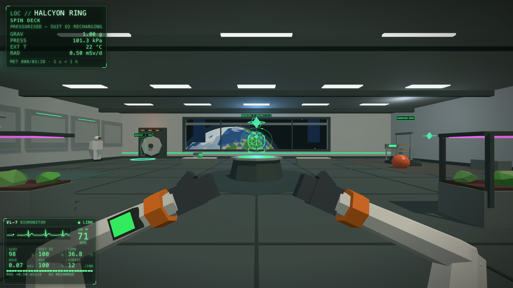
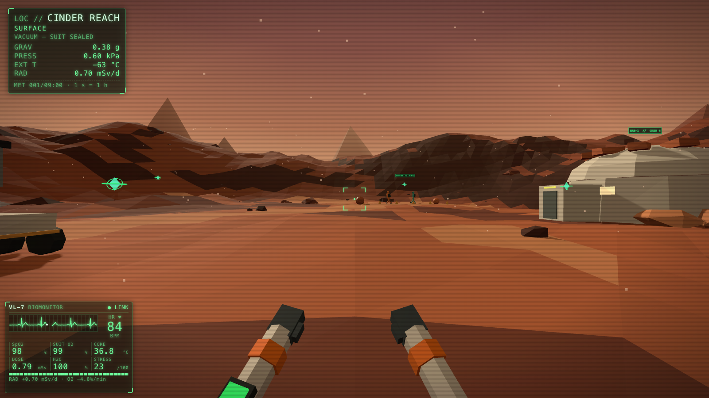

# Vital-Link

A first-person, low-poly WebGL game (three.js) that demos a wearable astronaut health monitor, shown as a retro green-phosphor wrist computer. A space station is the hub. From there you can take a drop pod to a planet or go out the airlock on a spacewalk. Scan points of interest to read space-physiology facts, and grab, throw and slap the wobbly soft-body objects and floppy ragdoll dummies.





## Run

Requires Node 20+ (the nvm default v18 is too old for Vite 8).

```sh
npm install
npx vite experiments/game   # run from the repo root
node experiments/game/scripts/smoke.mjs   # headless smoke test of physics, player and all levels
```


## Controls

| Input | Action |
|---|---|
| WASD / Mouse | Move / look |
| Shift | Sprint |
| Space | Jump (ascend in zero-g) |
| Ctrl or C | Descend in zero-g |
| Left mouse | Grab with physics arms; release to drop, flick to throw; wheel sets distance |
| Right mouse | Shove |
| F | Flop: go limp and tumble for a moment |
| E | Scan point of interest / use portal |
| Tab | Wrist device (vitals, codex, map) |

## Layout

```
src/main.js           frame loop, level loading, interactions
src/core/input.js     keyboard/mouse
src/core/physics.js   custom Verlet soft bodies, ropes, ragdolls
src/core/player.js    FPS controller, zero-g thrusters, floppy arms, grab
src/scenes/           station (hub), planet, spacewalk, shared low-poly helpers
src/ui/               wrist-device HUD, vitals simulation, codex
.agents/CONTRACT.md        module API contract
```
